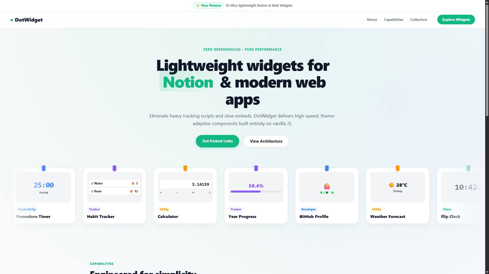
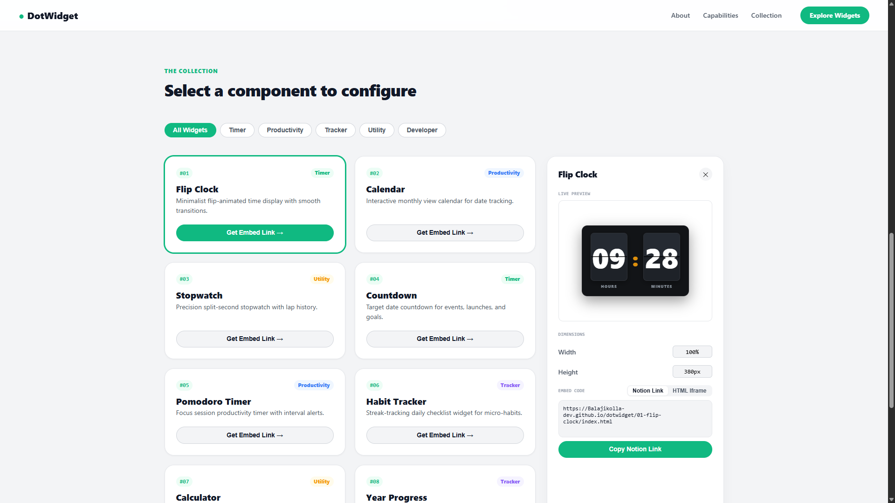

# DotWidget: Ultra-Lightweight Widgets for Notion & Web

  

> **Lightweight widgets for Notion & modern web apps.**
> Eliminate heavy tracking scripts and slow embeds. DotWidget delivers high-speed, theme-adaptive components built entirely on vanilla JS.

DotWidget is a growing collection of minimalist, zero-dependency widgets hosted via GitHub Pages, designed to be embedded effortlessly into **Notion** dashboards or any modern web application.

---

## ⚡ Key Features

*   **Zero Dependencies:** Built purely on Vanilla JS, ensuring maximum performance and minimum file size.
*   **Performance First:** Fast load times, optimized to run smoothly across all devices.
*   **Theme-Adaptive:** Designed to look great in both light and dark environments automatically.
*   **Seamless Integration:** Generates an embed link or Notion-specific URL instantly.

---

## 📂 The Collection

  

DotWidget currently includes (with more being added):

1.  **Flip Clock**
2.  **Calendar**
3.  **Stopwatch**
4.  **Countdown**
5.  **Pomodoro Timer**
6.  **Habit Tracker**
7.  **Calculator**
8.  **Year Progress**
9.  **GitHub Profile**
10. **Weather Forecast**

---

## 💻 Tech Stack & Design Choices

The architecture of DotWidget prioritized **simplicity and raw performance**.

*   **HTML5**
*   **CSS3**
*   **JavaScript (Vanilla):** *Chosen deliberately over a framework to eliminate the overhead of external libraries and ensure lightning-fast integration.*

---

## 🚀 How to Use

DotWidget is hosted live on GitHub Pages: [**Try the Demo**](https://balajikolla-dev.github.io/dotwidget)

1.  **Select:** Choose a widget from the [DotWidget Collection](https://balajikolla-dev.github.io/dotwidget).
2.  **Configure:** Adjust the dimensions if needed.
3.  **Embed:** Click "Copy Notion Link" or "HTML Iframe" and paste it directly into your destination app.

  

---

## 🛠️ Local Development & Contributing

Contributions, issues, and feature requests are welcome!

1.  Clone the repository: `git clone https://github.com/Balajikolla-dev/dotwidget.git`
2.  Open `index.html` in your browser.
3.  Submit a Pull Request.

## 📄 License

This project is licensed under the MIT License.
